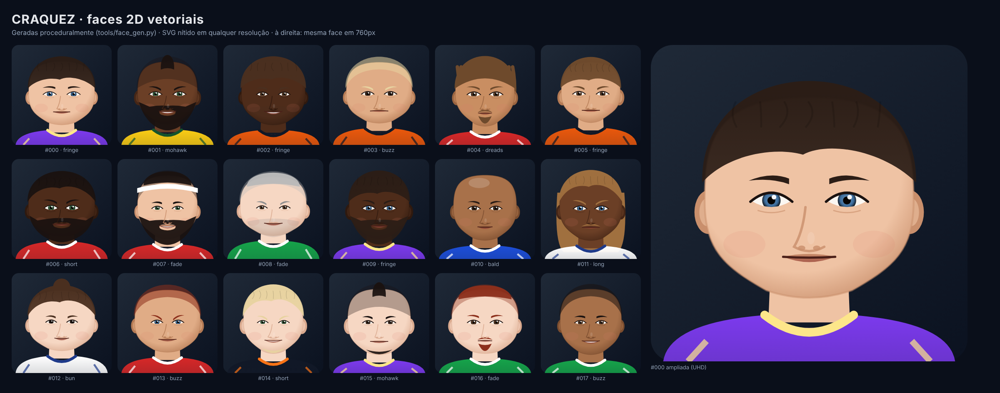

# ⚽ Craquez

Jogo de futebol 2D (vista 3/4 "2.5D") com física realista, para **Windows** e **Android**.
Modos **Campo (11×11)**, **Futsal (5×5)** e **Street (3×3 com tabela no muro)**.
PvP local, contra CPU e **PvP online** (por IP). Suporte a controles **Xbox / PlayStation**, teclado e toque.



## Destaques

| | |
|---|---|
| **Gráficos 2D UHD** | Tudo vetorial (campo, jogadores, rostos SVG) → nítido de 480p a 4K, sem pesar no download |
| **Física** | Bola 2.5D com gravidade, arrasto do ar, efeito Magnus (curva), quique por superfície (grama/madeira/asfalto), atrito de rolagem, traves e travessão |
| **Movimento** | Aceleração/frenagem, inércia em mudanças de direção, giro mais lento em velocidade, fôlego (stamina), condução de bola com toques |
| **Hardware modesto** | Renderer *GL Compatibility* (OpenGL 3.3 / GLES 3). Presets Baixa (854×480, 30 fps) → Ultra (nativo, MSAA 4x, 144 fps) e detecção automática |
| **Online** | Lockstep sobre ENet/UDP com entradas de 3 bytes, redundância e hash anti-dessincronia. Ver [docs/ONLINE.md](docs/ONLINE.md) |
| **Som** | Sintetizado em código: chute, apitos, trave, torcida que reage ao lance |
| **Regras** | Faltas, pênalti (campo/futsal), impedimento (campo), lateral, escanteio, tiro de meta |

## Como rodar

1. Instale o [Godot 4.4](https://godotengine.org/download) (versão padrão, não a .NET).
2. Abra o Godot → **Importar** → selecione `project.godot` desta pasta.
3. Aperte **F5**.

Builds automáticas: a cada push, o GitHub Actions roda os testes e gera o `.exe` (Windows) e um `.apk` de debug (Android) — baixe em **Actions → execução → Artifacts**.

## Controles

| Ação | Xbox | PlayStation | Teclado P1 | Teclado P2 |
|---|---|---|---|---|
| Mover | Analógico esq. / D-pad | Analógico esq. / D-pad | WASD | Setas |
| Passe (defesa: dividida) | A | ✕ | J | Num 1 |
| Chute — segure p/ força (defesa: carrinho) | B | ◯ | K | Num 2 |
| Passe alto / cruzamento | X | ▢ | L | Num 3 |
| Enfiada (defesa: chamar 2º marcador) | Y | △ | I | Num 5 |
| Correr | RT / RB | R2 / R1 | Shift | Num 0 |
| Trocar jogador | LB | L1 | Q | Num 4 |
| Pausa | Start | Options | P / Esc | Backspace |

No Android aparece um controle virtual na tela; controles Bluetooth também funcionam.
Dica: soltar o botão de passe/chute *antes* da bola chegar faz a jogada **de primeira**.

## Estrutura

```
scripts/
  sim/        simulação pura (sem engine): partida, bola, jogador, CPU
  core/       modos de jogo, times, InputFrame, leitura de controles, RNG determinístico
  view/       renderização 2.5D, HUD, controle de toque
  match/      nó da partida (passo fixo, provedores de entrada)
  net/        contrato de rede, replay, hash de estado
  ui/         menu principal
  art/        biblioteca de rostos (SVG → textura na resolução do preset)
  autoload/   Settings (qualidade, tempo de jogo…)
assets/faces/ 48 rostos SVG + metadados
tools/        face_gen.py (gera rostos novos)
tests/        testes headless da simulação
docs/         arquitetura, online, roadmap
```

Mais detalhes: [docs/ARQUITETURA.md](docs/ARQUITETURA.md) · [docs/ROADMAP.md](docs/ROADMAP.md)

## Rostos

```bash
python3 tools/face_gen.py --count 96 --seed 7
```

Gera novos rostos procedurais (tom de pele, cabelo, barba, olhos, formato do rosto). São placeholders de qualidade — o pipeline aceita rostos desenhados à mão em SVG no mesmo formato (512×512).
